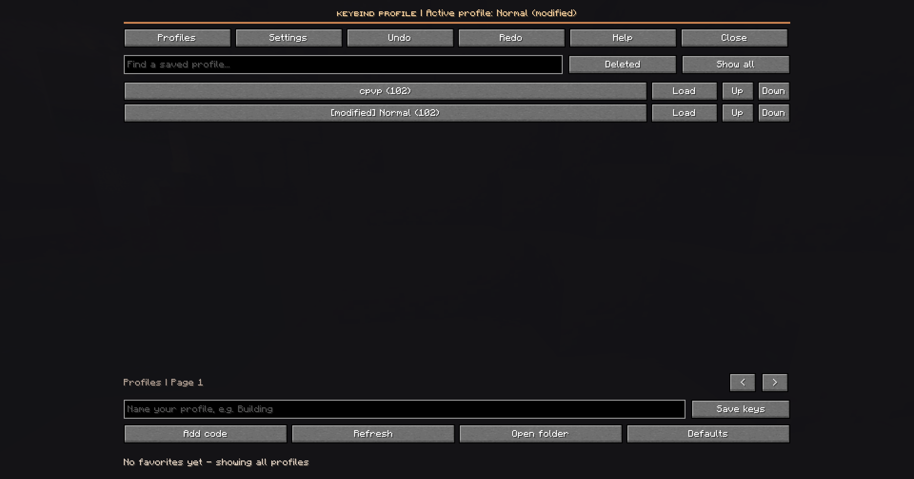
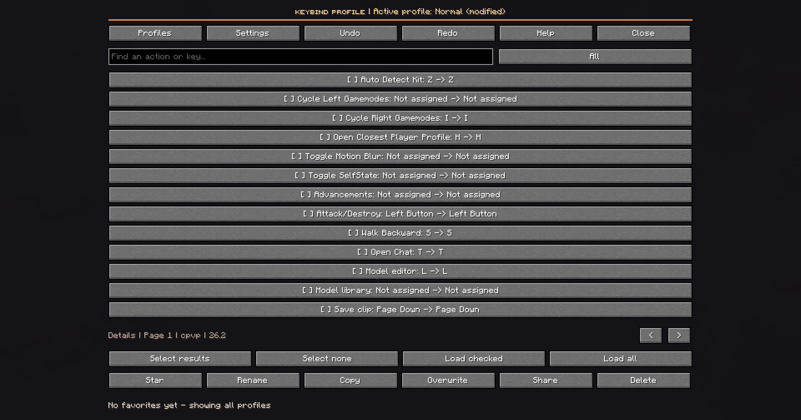
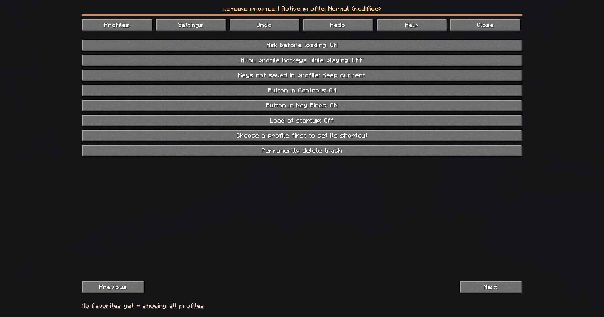
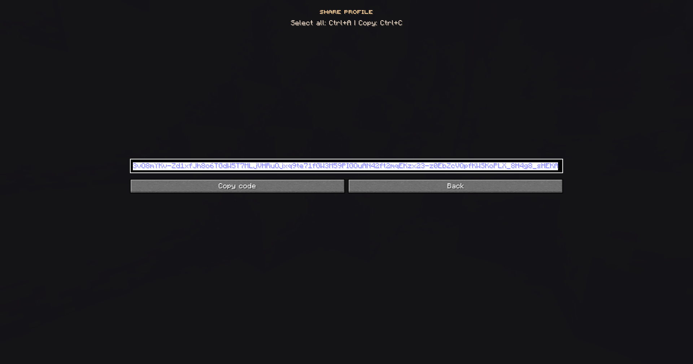
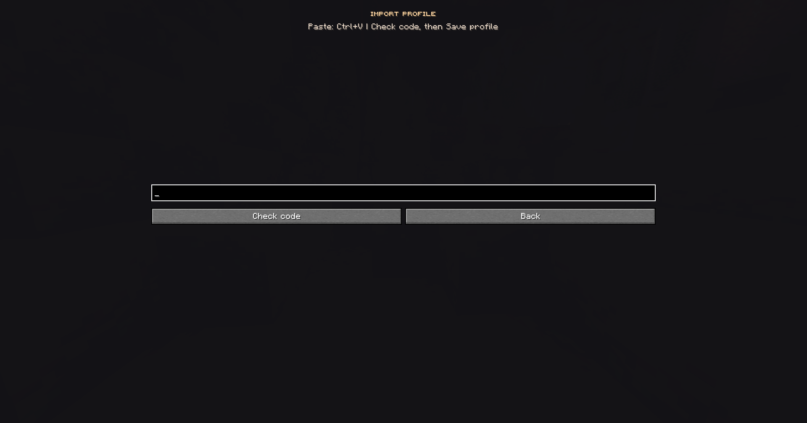
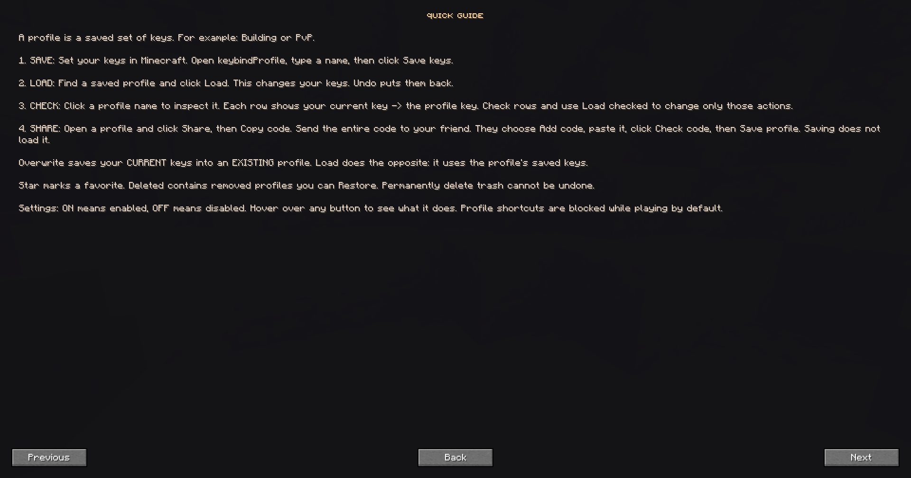
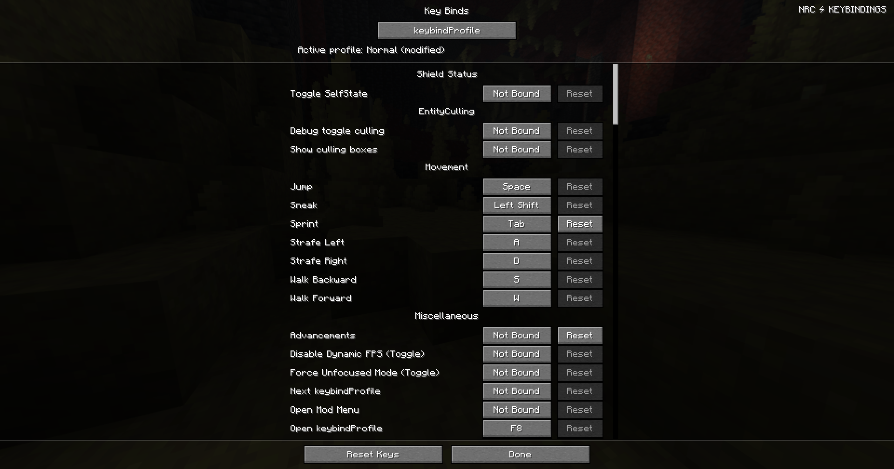
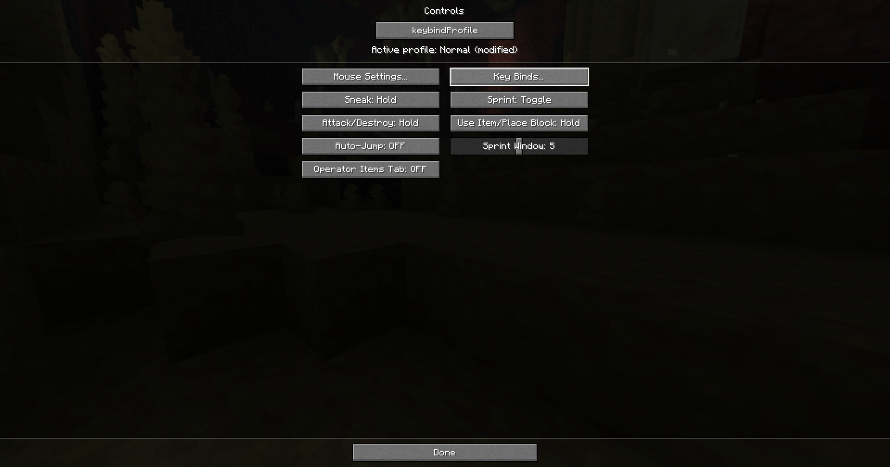

# keybindProfile 1.0.5

A newly written client-only Fabric mod for Minecraft 1.21.11, 26.1, 26.2 and 26.3. Install the JAR for your exact Minecraft release, not every JAR together. No QuickRebind source is included.

## Screenshots

User-provided screenshots.

## Install and remove

1. Close Minecraft yourself. No desktop automation or launcher changes are required.
2. Use Fabric Loader 0.20.1 or newer and Fabric API for the selected Minecraft version. Java 21 is required for 1.21.11; Java 25 for 26.x.
3. Put the matching keybindProfile JAR in that instance's mods directory. Remove earlier keybindProfile versions. QuickRebind is not required; if retained, its F8 shortcut can conflict, so rebind one of the shortcuts.
4. Start the instance. Open Controls or Key Binds and click keybindProfile centered below the menu title, or press F8. The open and cycle shortcuts are configurable in Minecraft's normal Key Binds menu.
5. To uninstall, close Minecraft and remove this mod's JAR. Existing Minecraft key assignments remain. Profile files and history remain until you remove them yourself.

## Quick start

A profile is a saved set of keys, such as Building or PvP.

1. Set your keys in Minecraft's Key Binds menu.
2. Open keybindProfile, enter a name and click **Save keys**.
3. Click **Load** beside a saved profile to use those keys. **Undo** restores the previous keys.
4. Click a profile's name to inspect it. Rows show **current key -> saved key**. Check individual rows and choose **Load checked** to change only those actions.

**Overwrite** saves your current keys into an existing profile. **Load** uses that profile's saved keys. These are opposite actions.

To share: open a profile, click **Share**, then **Copy code**, and send the entire code to your friend. They click **Add code**, paste with Ctrl+V, choose **Check code**, then **Save profile**. Saving an imported profile does not load it. Same-name imports get a new name automatically. KBP1 and KBP2 codes from this mod are supported.

Hover over buttons for explanations. Click **Help** for the in-game guide. Settings show ON or OFF. **Deleted** holds removed profiles; **Restore** brings one back. **Permanently delete trash** cannot be undone.

## Features and controls

- Save all currently registered bindings, apply, update, rename, duplicate and share profiles.
- Shared library: USER_HOME/.keybindProfile/profiles.json. Override with -Dkeybindprofile.dir=ABSOLUTE_PATH if wanted. The Open folder button uses the operating system file manager only when clicked, including headless Java launches.
- Per-instance settings and 20-step undo/redo: INSTANCE/config/keybindprofile.json.
- A single library file, unique temporary files, forced writes, atomic replacement and a cross-process write lock. Unsupported atomic moves fail rather than silently degrading safety. Corrupt files are preserved and block changes until repaired.
- Edits reject stale profile content. Refresh reads another instance's changes; there is no continuous filesystem polling.
- Search profiles; mark favorites; move profiles up/down. Favorites-only also controls the cycle shortcut. If no active favorites exist, the profile browser shows all profiles with an explanatory message.
- Select a profile to inspect bindings, current/target keys and the saved Minecraft version. Search by action label, binding ID or key. Filters: changed, shared-key conflicts, unbound, missing mods and selected.
- Select filtered bindings and apply only selected actions. Search a mod's binding prefix to select that subset. There is no separate mod/category dropdown.
- Full validation of installed target keys before any change. Unknown mod actions are retained in profiles without adding bindings to Minecraft.
- Missing actions can remain unchanged (default) or reset to their defaults.
- Confirm before apply is enabled by default and is respected by profile cycling and direct shortcuts. New shared-key groups always require confirmation. Conflict detection compares complete groups, not net counts. Shared keys may be intentional in context-dependent mods; these are warnings, not proof of incompatible actions.
- Direct profile keyboard shortcuts: open a profile, then Settings, then Shortcut; press a key, or Escape to clear. These shortcuts are per-profile, shared with the library, keyboard-only and do not support modifier chords. Duplicate assignments are rejected or ignored if introduced by another instance. Mouse bindings are still saved and applied as part of profiles.
- Accidental hotkey switches inside worlds are blocked by default. Settings can disable this protection; explicit menu actions remain available.
- Automatic startup application is opt-in and per-instance; it validates and backs up without a confirmation dialog.
- The last selected profile is marked active or modified when the profile list is rebuilt, based on its installed saved bindings. Partial application can therefore show modified.
- Undo/redo history is saved before binding changes. A late user key change cancels the operation without overwriting that change. In-memory application failures attempt rollback. Minecraft's own options.save method does not return a durable-write acknowledgement; filesystem errors inside Minecraft must still be checked in its log.
- Trash is reversible. Empty trash permanently deletes only trashed profiles after confirmation.
- Share creates compact KBP2 codes and still imports KBP1 codes. Import is bounded, validates schema and opens a preview before saving; imported shortcuts are cleared. QRB1 codes from QuickRebind are not imported.

## Build and tests

Use JDK 25 and the included Gradle wrapper:

    gradlew.bat :1.21.11:build :26.1:build :26.2:build :26.3:build

Stonecutter 0.9.8 maintains one source tree, with version conditionals. Fabric Loom 1.17.21 uses official Mojang mappings and remapping for 1.21.11; 26.x uses the non-remapping plugin. Release JARs are in versions/VERSION/build/libs. Do not install a sources JAR.

The core tests cover selection, missing actions, conflict replacement, bounded history, stale transactions, rollback, atomic persistence, inter-instance locking, corrupt files, schema/size validation and compressed input limits. They do not launch Minecraft.

## Validation limits

Compilation and automated core tests are checked separately for all four versions. No live NoRisk session, visual inspection, actual hotkey input or modpack interoperability has been tested. The button and title share the native header layout; the list viewport shrinks accordingly. Other mods replacing the header may need compatibility work. Extreme GUI scales and mod-provided custom screens need an in-game check. This release has not been installed into any live instance.

No network requests, account data collection, server changes, or background desktop control are used.

## 1.0.1 fixes

The menu entry is inserted once during native header creation, rather than appended after every screen initialization notification. Returning to a screen and resizing now use the native layout. The original title stays above the centered button; content clipping and list height follow the enlarged header. Existing profile files are unchanged. Empty search/trash states are explicit. A favorites filter with no favorites no longer hides every saved profile.

## 1.0.2 icon

The user-provided PNG is embedded unchanged and declared in Fabric metadata. The 1.0.1 menu fixes are included. Icon display depends on the client mod-list implementation.

## 1.0.3 usability and sharing

Clear action names, button explanations, a paginated in-game guide, readable key names and plain-language confirmations. Sharing opens a dedicated code screen; Copy code checks clipboard readback and reports errors. Imports accept wrapped whitespace and use unique names. Failed import saves retain their preview for retry. No network service is used. Automated clipboard tests use a substitute clipboard; real client clipboard behavior and visual layout still need in-game validation.

## 1.0.4 immediate key display refresh

After a profile, selected keys, defaults, undo or redo changes bindings, the vanilla Key Binds list refreshes its cached labels and conflict/reset indicators before its next rendered frame. This also covers returning from the profile manager to an already open Key Binds screen. The list is refreshed only when the binding revision changes, preserving scroll position and avoiding repeated work every frame. No extra key press is needed. In-game validation remains pending.

The profile manager and the native Controls/Key Binds header show the last loaded profile name. A modified suffix indicates that installed keys differ from that saved profile. Deleted or unavailable profiles show None. The label updates while these menus are open; it is not an in-world HUD. Loading an already matching profile also remembers its name.

## 1.0.5 compact sharing release

KBP2 stores only the profile name, Minecraft version and every saved binding. Repeated keys use a dictionary; sorted action names share prefixes. Gzip and URL-safe Base64 keep codes portable. Local IDs, favorites, ordering and shortcuts are not shared. No server, upload or account is involved. Old KBP1 codes remain importable; recipients need 1.0.5 or newer for KBP2. Codes still contain the complete profile, so their length depends on the number and names of bindings; they are not short online lookup IDs. All 1.0.4 display fixes are included. In-game validation remains pending.
